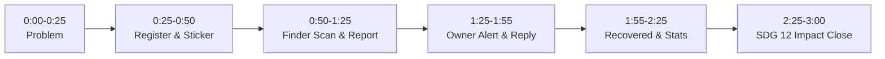

# CardWapas — 3-Minute Live Hackathon Demo Script

**Total Duration:** Exactly 3:00 minutes (180 seconds)  
**Team of 4:**
- **Person 1 (Backend Lead / Laptop Operator):** Leads opening problem statement, registers card, displays dashboard, clicks recovery.
- **Person 2 (Auth & Security Lead):** Highlights zero-knowledge privacy, rate limiting, and unguessable token security during the scan.
- **Person 3 (Frontend Lead / Finder Actor):** Holds phone in hand, scans printed sticker QR live, submits found report in 15 seconds.
- **Person 4 (Integrations & Demo Lead):** Explains real-time email notification, walks through live analytics counters, and delivers the SDG 12 closing hook.

---

## Pre-Demo Setup Checklist (2 Minutes Before Going on Stage)

| Item | Who | Description |
|---|---|---|
| **Laptop & Projector** | Person 1 | Logged in at `http://127.0.0.1:5000/dashboard` on Chrome. Fullscreen (`F11`). Zoom 125% for visibility. |
| **Physical Prop Card** | Person 1 | Real metro card with the CardWapas printable sticker stuck on it. |
| **Mobile Phone** | Person 3 | Connected to same Wi-Fi or hotspot. Camera app open. |
| **Backup Tab** | Person 3 | Tab with `/found/<token>` pre-loaded in Safari/Chrome in case venue Wi-Fi is spotty. |
| **Email Inbox / Terminal** | Person 4 | Owner's email inbox open on phone or laptop, with server terminal visible for console fallback. |

---

## Second-by-Second Demo Timeline

---

## Live Demo Script

### 1. The Problem Hook (0:00 – 0:25) — Speaker: Person 1
- **Action:** Person 1 stands center stage, holding up a plain, anonymous metro card.
- **Spoken:**
  > *"Judges, look at this metro card. Every single day in cities like Bengaluru, thousands of commuters drop their metro cards on trains, buses, and station concourses.
  > 
  > The problem? Prepaid transit cards are completely anonymous. There's no name, no phone number, and metro lost-and-found booths are slow and manual. Writing your personal phone number on your card with a permanent marker is an alarming privacy risk. When a card is lost, both the commuter's money and the plastic card itself are lost forever.
  > 
  > We built **CardWapas**—a zero-friction, privacy-first recovery platform that connects finders directly with owners in under 30 seconds."*

---

### 2. Register & Add Card (0:25 – 0:50) — Speaker: Person 1
- **Action:** Person 1 switches to laptop on projector screen (`/dashboard`). Types `"Daily Metro Pass"` into the **Add a card** field and clicks **Generate QR**.
- **Spoken:**
  > *"Here is our dashboard. In less than 10 seconds, an owner registers and adds a card label. CardWapas immediately generates a cryptographically secure, 128-bit unguessable token and a printable sticker.*
  > 
  > *(Person 1 holds up the physical card with the printed CardWapas sticker)*
  > 
  > *The sticker clearly says: 'Found this card? Scan to return it to its owner.' You print it once, stick it on your card, and you're protected for life."*

---

### 3. The Finder Experience (0:50 – 1:25) — Speakers: Person 3 & Person 2
- **Action:** Person 3 steps forward with a smartphone. Points phone camera at the physical sticker held by Person 1. The camera detects the QR and opens the URL. Projector or mobile screen mirroring shows the `/found/<token>` page.
- **Spoken (Person 3 - Finder):**
  > *"Now imagine I'm a commuter walking past the RVCE station entrance and I spot this dropped card on a bench. I pull out my phone and scan the QR.*
  > 
  > *Boom—I land directly on the report page."*
- **Spoken (Person 2 - Security Lead):**
  > *"Notice three critical security safeguards here:
  > 1. **Zero friction:** The finder did NOT have to download an app, create an account, or log in.
  > 2. **Complete privacy:** The owner's identity, phone number, and email address are 100% hidden.
  > 3. **Spam protection:** This route is rate-limited to 5 submissions per hour with CSRF protection."*
- **Action (Person 3):**
  > *Selects preset meetup point: **'RVCE main gate'**.*  
  > *Types short note: **'Left with campus security desk.'** (Finder contact field left optional).*  
  > *Clicks **'Report Found Card'**.*
- **Spoken (Person 3):**
  > *"I select a safe public meetup point—RVCE main gate—and hit submit. Total time taken: 12 seconds."*

---

### 4. Owner Notification & Reply (1:25 – 1:55) — Speakers: Person 4 & Person 1
- **Action:** Person 4 holds up their phone showing the live Gmail notification (or points to the terminal console showing the notification payload). Person 1 refreshes `/dashboard`.
- **Spoken (Person 4 - Integrations):**
  > *"Instantly, our background notification service fires. The owner receives an email notification: 'Good news! Someone found your card.'
  > 
  > Notice that the email stays strictly privacy-safe—no sensitive finder telemetry is leaked in transit. It contains a direct link back to the owner's authenticated dashboard."*
- **Action (Person 1):**
  > *Projector shows the new report card on the dashboard under **Found reports**.*  
  > *Types reply: **'Thank you so much! I will collect it from security at 5:00 PM.'** and clicks **'Send reply'**.*
- **Spoken (Person 1):**
  > *"On my dashboard, I see the meetup point and can immediately reply to coordinate the safe handover. Person 3's status link updates automatically."*

---

### 5. Safe Recovery & Live Analytics (1:55 – 2:25) — Speakers: Person 1 & Person 4
- **Action:** Person 1 clicks the green **'Mark as recovered'** button. The report status badge flips to `recovered`.
- **Spoken (Person 1):**
  > *"Once I retrieve my card, I click 'Mark as recovered'."*
- **Action (Person 4):**
  > *Points to the 4 stat counters at the top of the dashboard.*
- **Spoken (Person 4):**
  > *"Look at our live impact analytics at the top of the screen:
  > - Cards registered: **1**
  > - Found reports: **1**
  > - Recovered cards: **1**
  > - Average recovery turnaround: **0.1 hours**
  > 
  > Our analytics engine automatically computes real-time recovery rates and turnaround times without zero-division pitfalls."*

---

### 6. SDG 12 Impact Close (2:25 – 3:00) — Speaker: Person 4
- **Action:** All 4 team members stand together facing the judges. Person 4 delivers the closing.
- **Spoken (Person 4):**
  > *"CardWapas is not just an app; it is a direct driver of **UN Sustainable Development Goal 12: Responsible Consumption and Production (Target 12.5)**.
  > 
  > Over 15 million smart cards are manufactured globally every year using virgin PVC plastics and microchips. When a card is recovered instead of replaced, we eliminate unnecessary plastic production, avoid electronic e-waste, and save commuters money.
  > 
  > It is built on a lightweight, rock-solid Python and Flask stack, requires zero metro infrastructure integration to start, and can be deployed across university campuses and metro systems tomorrow.
  > 
  > Don't replace it—CardWapas it! Thank you!"*

---

## Emergency Fallback Matrix (What to do if...)

| Issue During Live Demo | Immediate Fallback Action |
|---|---|
| **Venue Wi-Fi drops** | Person 1 runs Flask on `localhost:5000` on laptop. Person 3 opens the pre-cached tab or uses mobile hotspot. |
| **Email fails or delays** | Person 4 points to the terminal console: *"Our system has a built-in console fallback that logs the exact email payload instantly, ensuring the demo never stalls."* |
| **Phone camera won't focus on QR** | Person 3 clicks the bookmark to `/found/<test-token>` pre-saved in the phone browser. |
| **Time running low (< 45s left)** | Skip typing the custom reply message; click 'Mark as recovered' immediately and jump to the SDG 12 close. |
