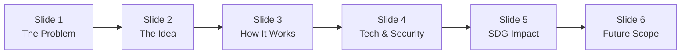

# CardWapas — 6-Slide Hackathon Pitch Outline

**Presentation Target:** 3 to 5 minutes  
**Primary SDG:** SDG 12 (Responsible Consumption & Production — Target 12.5: Waste Reduction through Reuse)  
**Secondary SDG:** SDG 9 (Industry, Innovation & Infrastructure — Target 9.c: Accessible Digital Technology)

---

---

## Slide 1: The Problem — Anonymous Cards, Lost Value & E-Waste

### Slide Visual / Layout
- **Left:** Photo of a generic lost metro card on a railway platform or bench.
- **Right:** 3 stark pain-point callout boxes:
  - 🚇 **100% Anonymous:** Metro cards carry zero owner identification. Lost cards cannot be traced or returned.
  - 🔒 **Privacy Dilemma:** Writing phone numbers with permanent marker leaks sensitive personal data to strangers.
  - ♻️ **Plastic & Financial Waste:** Commuters forfeit stored balances; millions of PVC smart cards are discarded and reprinted.

### Key Talking Points (Speaker: Person 1)
- Thousands of commuters lose prepaid metro cards every month.
- Metro lost-and-found counters are slow, paper-based, and rarely result in recoveries.
- When an anonymous card is lost, both the money on the card and the plastic card itself are lost permanently.
- Existing options force a terrible trade-off: surrender your card or compromise your privacy by handwriting your personal phone number on the card.

---

## Slide 2: The Idea — CardWapas: Privacy-First Lost Card Recovery

### Slide Visual / Layout
- **Hero Image:** Visual of the CardWapas printable sticker stuck neatly on a metro card:  
  *“Found this card? Scan to return it to its owner.”*
- **Tagline:** *“Direct peer-to-peer lost card recovery with zero app installs, zero friction, and complete privacy.”*
- **Core Value Pillars:**
  - ⚡ **30-Second Turnaround:** Finders report with a single camera scan.
  - 🛡️ **Zero-Knowledge Privacy:** Owner identity and phone number remain completely confidential.
  - 🤝 **Safe Public Meetups:** Preset campus & transit meetup spots avoid awkward or unsafe exchanges.

### Key Talking Points (Speaker: Person 1 or Person 2)
- CardWapas bridges the gap between the finder and the owner without requiring middleman bureaucracies or transit authority integration.
- The owner generates a unique, cryptographically random QR sticker and sticks it to their card.
- If lost, any good Samaritan can scan it instantly with standard smartphone cameras—no app store downloads or sign-ups required.

---

## Slide 3: How It Works — The Seamless 4-Step Recovery Loop

### Slide Visual / Layout
- **Four-Step Workflow Diagram:**
  1. **Generate & Affix (Owner):** Owner registers card and downloads custom QR sticker.
  2. **Scan & Report (Finder):** Finder scans QR, chooses safe public meetup spot, and leaves note.
  3. **Alert & Coordinate (System):** Owner receives instant email alert and replies via dashboard.
  4. **Handoff & Recover (Community):** Card handed over safely; owner marks card as recovered.

### Key Talking Points (Speaker: Person 3)
- **Step 1:** The owner registers once, names their card, and prints the sticker generated by our Pillow engine.
- **Step 2:** The finder scans the QR, lands directly on a mobile-optimized public page, selects a safe public location (e.g. RVCE main gate or station concourse), and submits.
- **Step 3:** The owner is immediately notified by email, logs into their private dashboard, and coordinates pickup.
- **Step 4:** Upon pickup, one click marks the card as recovered, updating live impact metrics.

---

## Slide 4: Tech Stack & Privacy-First Security Architecture

### Slide Visual / Layout
- **Clean Architecture Grid:**
  - **Backend:** Python 3, Flask, Flask-SQLAlchemy (SQLite / PostgreSQL ready).
  - **Security & Privacy:** Flask-Login, Werkzeug password hashing, Flask-Limiter (5/hr rate limits), CSRF protection, 128-bit unguessable URL tokens.
  - **Services Engine:**
    - `services/qr.py`: Pillow-powered printable sticker and QR generator.
    - `services/notify.py`: Resilient SMTP notifier with short timeouts and console fallback.
    - `services/analytics.py`: Real-time impact aggregator with zero-division safety.
  - **Frontend:** Responsive Bootstrap 5 + Jinja2 (Zero build step, mobile-first design).

### Key Talking Points (Speaker: Person 2 & Person 4)
- **Engineered for reliability:** Built with a clean separation of concerns and battle-tested Python libraries.
- **Privacy by Design:**
  - QR codes contain ONLY unguessable tokens (`secrets.token_urlsafe(16)`), never personal identifiers or session cookies.
  - Public routes never render the owner's name, email, or phone.
  - Finder submission routes enforce strict rate limiting to prevent spam.
- **Robust Fail-Safe Integrations:** The notification pipeline features a strict 5-second socket timeout and never raises exceptions, guaranteeing uninterrupted user experience even if external mail providers fail.

---

## Slide 5: SDG Impact — Driving Responsible Consumption (SDG 12)

### Slide Visual / Layout
- **Center:** Official UN SDG 12 Icon (*Responsible Consumption & Production*).
- **Impact Metrics Grid:**
  - 🔄 **SDG Target 12.5:** Substantially reduce waste generation through prevention, reduction, recycling, and **reuse**.
  - 📉 **E-Waste & Plastic Reduction:** Every card recovered saves 5 grams of virgin PVC plastic and eliminates embedded RFID microchip waste.
  - 💰 **Economic Resilience:** Protects student and daily commuter balances from permanent loss.
  - 📊 **Real-Time Analytics Dashboard:** Transparent tracking of registered cards, reports submitted, and hours to recovery.

### Key Talking Points (Speaker: Person 4)
- Globally, billions of PVC smart cards are manufactured annually. Replacing a lost card incurs manufacturing emissions, plastic waste, and replacement fees.
- CardWapas directly advances **SDG 12.5** by enabling card **reuse** instead of disposal.
- With our built-in analytics service, campuses, metro systems, and corporate offices can measure their tangible plastic savings and recovery velocity in real time.

---

## Slide 6: Future Scope & Scaling Roadmap

### Slide Visual / Layout
- **Horizontal Roadmap Timeline:**
  - **Phase 1 (Current MVP):** QR sticker generation, privacy-preserving finder portal, email alerts, recovery analytics.
  - **Phase 2 (Immediate Extension):** WhatsApp and SMS webhooks via Twilio for instant chat-based notifications; Leaflet OpenStreetMap drop-pins for precise meetup coordination.
  - **Phase 3 (Enterprise & Hardware):** NFC-embedded sticker tags; BMRCL / transit authority API integration for card balance verification; white-labeled rollouts for college campus ID cards and corporate keycards.

### Key Talking Points (Speaker: Person 1 / All)
- We started with metro cards because they are universally anonymous and frequently lost.
- But the CardWapas recovery engine applies to **any high-value anonymous object**: campus IDs, library cards, bicycle tags, and luggage.
- By combining zero-friction public reporting with unbreakable privacy, CardWapas turns ordinary commuters into a collaborative, community-driven recovery network.
- **"Don't replace it — CardWapas it!"**
